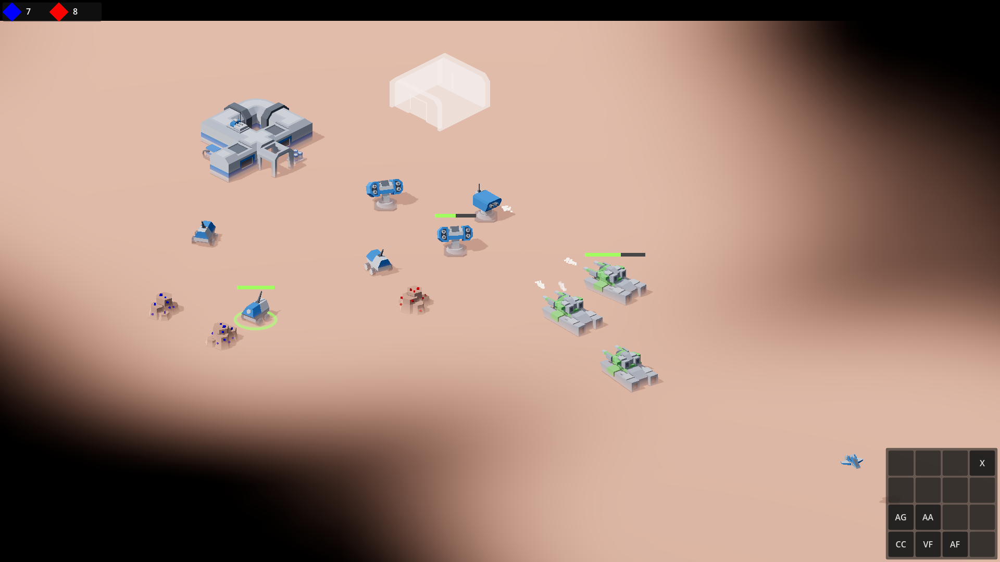
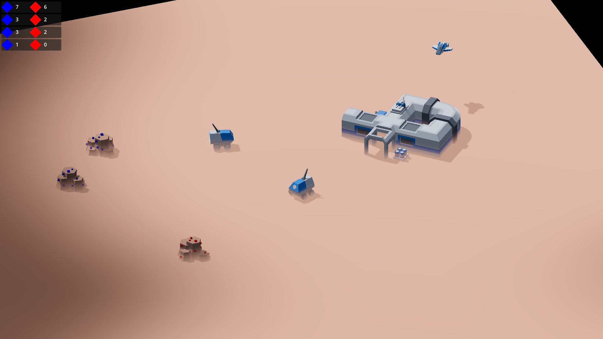

# Open RTS


Open Source real-time strategy game made with Godot 4.

## Game design

The evolving design for the programmable combat RTS is recorded in
[the living game design document](docs/GAME_DESIGN.md), including confirmed
decisions, proposed mechanics, and open questions.

The [core gameplay specification](docs/CORE_GAMEPLAY_SPEC.md) defines the next two-faction milestone: economy, chips, direct-order precedence, counters, repair limits, campaign/maps, program authoring and acceptance gates. Its recommendations are grounded in the [prototype playtest review](docs/playtests/2026-10-01/REVIEW.md); section 19 of the living design records the implemented skirmish subset; basic chip presets and parameter reuse now work. A [bounded native Lua runtime](docs/LUA_RUNTIME.md) and unit-action adapter are implemented and tested; a [paused Lua editor and exact-version source library](docs/playtests/2026-10-02/LUA_AUTHORING.md) are now available. A [visual rule editor](docs/playtests/2026-10-02/VISUAL_RULES.md) now generates the same bounded Lua programs. A [battle test arena](docs/playtests/2026-10-02/BATTLE_ARENA.md) runs seven real-unit scenarios in a separate window. The [Supply Line convoy opening](docs/playtests/2026-10-02/SUPPLY_LINE.md), [First Orders campaign tutorial](docs/playtests/2026-10-02/FIRST_ORDERS.md), [Split Signal relay operation](docs/GAME_DESIGN.md#42-split-signal-campaign-operation--2026-10-02) [Air Corridor evacuation](docs/playtests/2026-10-03/AIR_CORRIDOR.md), [Broken Foundry capture](docs/playtests/2026-10-03/BROKEN_FOUNDRY.md), and [Command Horizon finale](docs/playtests/2026-10-03/COMMAND_HORIZON.md) are selectable in Campaign and playable without code or a network. A [battle archive](docs/SAVE_LOAD.md) now restores skirmishes and all six campaign operations, including programs, orders and fog. The Lua editor now includes an optional [AI assistant and offline parameters](docs/LUA_RUNTIME.md#llm-authoring-ui-and-offline-parameters--2026-10-02); local flows are verified, while live-provider acceptance, final environments and broader balance remain in development.

Command Horizon now has a [first environment kit pass](docs/playtests/2026-10-03/HORIZON_ENVIRONMENT.md): industrial landmarks, varied rock cuts, worn roads and verified aircraft clearance. [Industrial Crossroads](docs/playtests/2026-10-03/INDUSTRIAL_CROSSROADS.md) adds a three-street skirmish district and detailed buildings shared with Broken Foundry. [Moving neutral life](docs/playtests/2026-10-03/AMBIENT_LIFE.md) adds civilian traffic, walking residents and wildlife across six maps. [Neutral world interaction](docs/playtests/2026-10-11/neutral-world/README.md) adds eight-person infantry garrisons, explicit neutral targeting, panic reactions, animated destruction and persistent ruins. Right-click a habitable building with infantry to enter; select its occupants and move or choose **Leave building** to exit. Use **Attack target** (default **T**) to attack a neutral building with infantry. [Expanded infantry and faction heroes](docs/playtests/2026-10-11/infantry-heroes/README.md) adds rifle, anti-armor, sniper and assault infantry, plus one unique hero per player with a persistent gold aura. Train heroes at barracks after building a command lab; alive and queued heroes share the same limit, and fallen heroes can be retrained. [Coastal Foundry](docs/playtests/2026-10-03/COASTAL_FOUNDRY.md) adds a harbor inlet, two ground routes, an air shortcut, cranes, vessels and gulls. Its [coastal environment pass](docs/playtests/2026-10-04/COASTAL_ENVIRONMENT.md) now adds continuous sea/terrain, breakwaters and rocky headlands, port service yards and wind-shaped pines. [Desert Frontier](docs/playtests/2026-10-03/DESERT_ENVIRONMENT.md) now has layered sandstone shelves, canyon surroundings, abandoned extraction/freight landmarks and varied sand/haul-road materials. [Alpine Relay](docs/playtests/2026-10-03/ALPINE_ENVIRONMENT.md) adds glacial shelves, snowy mountain and conifer surroundings, communications stations and connected plowed routes. Final environment work remains in progress.

[Resource navigation and map startup](docs/playtests/2026-10-03/RESOURCE_NAVIGATION.md) now have verified narrow-gap routing, reliable gathering/delivery, and per-battle navigation. The field-access audit covers both factions and all 11 resource-bearing maps. [Crowded Move destinations](docs/playtests/2026-10-04/CROWDED_DESTINATION.md) now settle beside an ally occupying the final reachable point, allowing queued orders and stationary treatment to continue. [Blocked assignments](docs/playtests/2026-10-04/BLOCKED_ASSIGNMENTS.md) identify owned-structure obstructions and retain Lua guard boundaries after loading.

[Air-defense guidance](docs/playtests/2026-10-05/AIR_DEFENSE.md) now selects compatible counters or offers existing anti-air cover, explicit Helix stance controls and real construction guidance when aircraft threaten your economy. [Live research feedback](docs/playtests/2026-10-05/RESEARCH_FEEDBACK.md) shows progress, available choices and lab-loss stalls in the existing command message area. [Resource inspection](docs/playtests/2026-10-05/RESOURCE_INSPECTION.md) shows observed deposit stock and wreck recovery details in one hover card, and aircraft ownership captions now respond to the pointer. The [engineer shortcut](docs/playtests/2026-10-05/ENGINEER_RESPONSE.md) selects endangered workers during raids and preserves their orders until you explicitly move them. Selected engineers can [Return cargo](docs/playtests/2026-10-06/CARGO_RETURN.md) to their nearest completed friendly HQ; hold Shift to queue delivery after a retreat.

[Faction and unit audio](docs/playtests/2026-10-11/audio-enhancement/README.md) now gives
all three factions distinct announcers, character-specific synthetic unit voices,
autonomous machine responses, research/construction/production cues and subtle UI
sounds. A shared priority queue, cooldowns and duplicate suppression keep battle
notifications from overlapping. Speech follows **Voice volume**; machine and UI
sounds follow **Effects volume**.

## Play skirmish

Run `project.godot` in **Godot 4.6** and choose **SKIRMISH**, or double-click [`play-skirmish.command`](play-skirmish.command) on this Mac.

- Play **Bastion**, **Helix**, or **Free Frontier**, against any faction or **Random** (mirror matches supported).
- Choose **Desert Frontier** (central staging ground and two flanks), **Alpine Relay** (passes and capturable vision relays), **Industrial Crossroads** (three streets, opaque buildings and vision relays), **Coastal Foundry** (harbor inlet, quay/inland routes and air shortcuts), **Open Plains**, or **Great Expanse**, plus **Easy / Normal / Hard** AI.
- **Standard:** HQ, four engineers, two infantry, 60 materials / 12 electronics. **Advanced:** established base, tanks and repair support, 120 / 60.
- **Economy:** each resource field has five material piles and two electronics piles. The four main skirmish maps contain 400 materials / 720 electronics per home pile and 600 / 1,200 per expansion pile. Full heaps change into opened bundles, scattered parts, and scraps at 300, 150, and 60 remaining; empty piles disappear. Electronics take 1.5 seconds per item to collect. Repair units, walkers, heavy armor and gunships have lower electronics costs across all factions. HQs supply 8 power and generators supply 12: a full production/technology/defense base needs two generators, with more required as production expands.
- **Battle plan:** collapsible guidance from resource gathering to chips, programs, army buildup and assault, with idle-engineer and army selection shortcuts. Recovery advice covers depleted fields, lost engineers, paid queue refunds and HQ rebuilding; queue cancellation also works while paused. [Supply guidance](docs/playtests/2026-10-04/ECONOMY_SUPPLY.md) prioritizes defense over field reassignment and identifies missing material/electronics income using faction armor, aircraft and chip costs. [Verified opening loop](docs/playtests/2026-10-02/SKIRMISH_LOOP.md).
- Harvest, construct, produce, repair and fight with all three faction rosters. Each side has a **100 mobile-unit cap**, including queued reinforcements, and a separate **40-structure cap** including foundations.
- **Default keys:** **M + left-click:** move without engaging. **T + enemy click:** attack a visible target. **F + left-click:** attack move. The selection panel has matching buttons; hold **Shift** when choosing the target to queue. **Esc / right-click** cancels targeting. [Direct command verification](docs/playtests/2026-10-04/DIRECT_ORDERS.md). **Space:** tactical pause with orders, construction and production available. **Esc:** controls, resume, restart, setup or main menu.
- **Options / Esc → Settings:** preview master/voice/effects volume, speech subtitles (three text sizes), camera speed, edge scrolling, window mode, pointer confinement and reduced flashes. Save keeps changes; Cancel/Esc restores them. **Controls** remaps 33 battle, camera, queue/selection and control-group actions, with conflict feedback and per-action reset. Displayed battle shortcuts follow your bindings. Tab/Enter navigate controls; Esc cancels capture or closes dialogs. See [controls verification](docs/playtests/2026-10-03/KEY_CONTROLS.md). Subtitles remain readable with audio muted. Urgent warnings take priority over routine voice responses; repeated casualties no longer restart a line for each loss. [Speech verification](docs/playtests/2026-10-03/SPEECH_ACCESSIBILITY.md). Attacks, hits and infantry/vehicle/building destruction have distinct combat sounds, with stereo direction and current-fog filtering. **Test combat sound** previews the Effects setting. [Combat audio verification](docs/playtests/2026-10-03/COMBAT_AUDIO.md).
- **Interface size:** Settings → General → Display offers **100%, 125%, and 150%**, with live preview and Save/Cancel. It scales menus, battle controls and text; subtitle size remains adjustable separately. [Scaling verification](docs/playtests/2026-10-03/INTERFACE_SCALE.md).
- **Alerts:** open the top-right history to inspect incoming fire, grouped losses, idle engineers, depleted fields, stranded cargo, low power and blocked production. **Show** selects affected friendly units and centers the camera; **Go to field** visits the assignment area. Both work while paused. Close with the displayed Menu key; Clear history retains active problems. [Alert verification](docs/playtests/2026-10-03/BATTLE_ALERTS.md).
- **Esc → Save / Load battle:** five manual slots and three campaign checkpoints. **F5:** quicksave. **F9:** review quickload. The main menu also has **LOAD BATTLE**. Loaded battles remain paused until Resume.
- Select a programmable unit → **Visual rules** for ordered condition/action cards, thresholds, optional states and generated-code preview. Check samples, save a version, then explicitly Apply. **Copy as Lua** preserves the visual original and opens a separate source draft.
- In either editor, **Battle arena** tests the current draft with real units in an isolated desktop window. Choose a role/scenario, run, inspect expected outcomes and traces, then return. The live battle stays paused. Save records matching scenario evidence; Apply remains explicit.
- Select a programmable unit → **Lua editor** to draft, check sample inputs, save a version and explicitly apply it. Closing restores the prior pause state. Factory program selectors accept saved Lua versions. Custom Lua needs the [native runtime build](native/rts_lua/README.md); built-in presets remain available without it.
- In **Lua editor → AI assistant**, configure your provider and API key, then Create/Revise/Explain. Review before **Import as unsaved draft**; check, save and apply separately. Provider API charges are separate. Use **Parameters** for supported offline adjustments. Visual-rule drafts can enter this flow through **Copy as Lua**.
- Destroy the enemy HQ and prevent a completed replacement for **60 seconds**. Losing every unit/building also ends the match. Victory, defeat and draw screens support replay and return to setup.


Helix uses its own models, icons and names: mobile units have 20% less health and 20% faster movement than Bastion counterparts; Prism artillery has longer range and slower movement. Costs and progression are initial tuning. The AI gathers and pays for units, buildings and research, reserving eligible technology costs while prioritizing rebuilding and urgent production. Difficulty changes decision and attack timing without economic or combat bonuses. See [paid progression verification](docs/playtests/2026-10-05/PAID_PROGRESSION.md) and the [reproducible match runner](tests/playtest/README.md).

[Implemented rules and limits](docs/GAME_DESIGN.md#19-playable-two-faction-skirmish--implemented-2026-10-01) · [Helix in battle](art/skirmish/helix-factory.png) · [Verification report](docs/playtests/2026-10-01/SKIRMISH.md)

```sh
godot --headless --path . --fixed-fps 60 --script tests/headless/Skirmish.gd
godot --headless --path . --fixed-fps 60 --script tests/headless/NavigationRegression.gd
godot --path . --fixed-fps 60 --script tests/rendered/SkirmishPreview.gd
```

Combat now includes armor/weapon counters, blocked sight and fire, non-stacking repair, infantry/aircraft recovery, recoil, tracers, missile trails, impacts and temporary wrecks. [Watch the combat preview](art/skirmish/combat-preview.mp4) · [Rules and measurements](docs/playtests/2026-10-01/COMBAT.md) · [Development roadmap](docs/DEVELOPMENT_ROADMAP.md).

Both factions now have individual long-idle gestures, gait/hover timing, recoil and death variations. [Watch the idle/combat review](art/skirmish/unit-motion-preview.mp4) · [Motion rules and verification](docs/playtests/2026-10-01/UNIT_MOTION.md).

Basic unit programs are playable: use an Advanced start, select chipped tanks/robots, choose Hold/Guard/Escort/Patrol, assign an area or target, then **Apply & run**. Direct orders suspend automation until **Resume**. Standard starts unlock programs through the vehicle producer and lab. Tanks can be retrofitted or produced with chips. Preset parameters can be saved as reusable versions. [Controls, verification and remaining work](docs/playtests/2026-10-01/PROGRAMS.md).

```sh
godot --headless --path . --fixed-fps 60 --script tests/headless/CombatRegression.gd
godot --path . --fixed-fps 60 --disable-vsync --script tests/headless/ScaleBenchmark.gd
godot --path . --fixed-fps 60 --script tests/rendered/CombatPreview.gd
```

## Bastion campaign

Campaign now offers **Supply Line** (convoy control), **First Orders** (program tutorial), **Split Signal** (multiple relay assignments), **Air Corridor** (air/ground evacuation), **Broken Foundry** (urban production and capture), and **Command Horizon** (deployment defense and HQ assault). In Air Corridor, destroy both AA batteries, position your escort, then launch flights one at a time. Stop/redirect for repairs and use **Continue flight** to resume; two safe flights let you finish or attempt the third for optional support. In Broken Foundry, destroy both production nodes to cancel unfinished enemy units, then bring infantry to capture and secure the foundry. Keep repair support protected and use the barracks to replace lost capturers. In Command Horizon, secure deployment with infantry, leave a guard and send a separate mixed force against the HQ. Foundry completion opens a northern ground passage; finale victory unlocks Lean and Reinforced replay variants. The [verification report](docs/playtests/2026-10-03/COMMAND_HORIZON.md) records tested routes and remaining balance/environment work.

Choose **CAMPAIGN → First Orders → Start First Orders**. Build a command lab with an engineer, assign your repair robot a Service area and Apply & run, then send infantry and tanks to the marked relay. Hold it for 60 uncontested seconds against three warned Helix responses. Story/Standard/Veteran select 3/4/5 units per response. Tactical pause and direct orders remain available.

Saving, loading and applying a changed retreat threshold earns an optional cosmetic badge. Mission completion and the badge persist. Full battle saves are available through **Esc → Save / Load battle**. Three checkpoint slots rotate at operation start, lab completion, program assignment and relay capture. [Rules, checks and screenshots](docs/playtests/2026-10-02/FIRST_ORDERS.md).

```sh
godot --headless --path . --fixed-fps 60 --script tests/headless/CampaignRegression.gd
godot --path . --fixed-fps 60 --script tests/rendered/CampaignPreview.gd
```

## Bastion playable demo

Open `project.godot` in **Godot 4.6**, run the project, and choose **BASTION DEMO**. On this Mac, double-click [`play-bastion.command`](play-bastion.command) to launch directly. A Godot executable is required; the launcher checks the local tool download, cache, application folder, and PATH.

The desert scenario starts with the full faction available for review: **8 mobile unit types, 9 structures, materials/electronics harvesting, power capacity, construction, production, repairs, fog of war, and an AI opponent**. Reinforcements cost resources; the command lab unlocks walkers and railgun tanks. Destroy all enemy units and structures to win. Use **SKIRMISH** for the two-faction mode described above.


- **Left-click / drag:** select. **Shift:** add to selection. **Right-click:** move, attack, harvest, repair an ally, or set a factory rally point. **Shift + right-click:** append an order (up to 16 waiting). **Shift + attack-move click:** append an attack-move.
- **Specialist programs:** armor can hold standoff range, aircraft can strike once and regroup, walkers can hold a fire-support point, and scouts/repair robots have role-specific defaults. Assign the required area, route, escort or regroup point before running.
- **Squads:** research Coordination at your lab, select mobile units and create a named squad (24 maximum). Membership preserves orders. Choose Spread fire, Focus fire or Independent; select the squad to apply presets to chip-ready members.
- **Order queue:** numbered routes show active (solid) and waiting (dashed) orders. Skip advances one order; Clear waiting keeps the active order; Stop clears everything. Auto-resume program is optional and off by default.
- **Engineer rover:** select a building in its menu, place it with the left mouse button, and rotate with **R** or by dragging before release. Right-click cancels placement.
- **Production:** select a headquarters, barracks, vehicle factory, or airfield. Click a roster icon to queue; click a queue icon to cancel and refund.
- **Space:** tactical pause in the Bastion demo; select units, give orders, and queue production while paused. **Escape:** match menu.
- **WASD / screen edges:** pan. **Q/E:** rotate. **Mouse wheel:** zoom. **Ctrl+1–9:** assign control groups; **1–9:** recall.

Assets and implementation:

- [Editable Blender faction catalogue](art/bastion/demo/bastion_faction.blend) · [asset overview](art/bastion/demo/faction-catalogue.png) · [construction UI](art/bastion/demo/gameplay/construction.png)
- [Rebuild script](art/bastion/build_faction.py) · [20 GLB exports](assets/models/bastion/demo) · [unit/building icons](assets/ui/bastion) · [verified mesh counts](art/bastion/demo/verification.json)
- [Gameplay specification and prototype limitations](docs/GAME_DESIGN.md#16-bastion-asset-and-gameplay-demo--implemented-2026-10-01)

Rebuild the assets with `blender --background --factory-startup --python-exit-code 1 --python art/bastion/build_faction.py`. The script uses the original tank export in `assets/models/bastion/tank-v1/` and saves editable source, GLBs, icons, and a catalogue render. Validate exports with the same command using `art/bastion/verify_faction.py`.

Verification commands, from the project directory:

```sh
godot --headless --editor --path . --import
godot --headless --path . --script tests/headless/MatchStartup.gd
godot --headless --path . --script tests/headless/BastionDemo.gd
godot --path . --script tests/rendered/BastionPreview.gd
gdformat --check source/
gdlint source/
```

Latest gameplay verification: [repeated skirmishes, repair support and movement completion](docs/playtests/2026-10-03/SKIRMISH_MATRIX.md), followed by [crowded-base movement and archive continuity](docs/playtests/2026-10-03/CROWD_BOUNDARIES.md), [AI construction that preserves base access](docs/playtests/2026-10-03/BASE_ACCESS.md), [tactical guidance and reliable selection](docs/playtests/2026-10-03/BATTLE_PLAN.md), [Guard coverage across its assigned area](docs/playtests/2026-10-03/GUARD_AREA.md), [observed-threat AI defense](docs/playtests/2026-10-04/AI_DEFENSE.md), [observed-composition counter-production](docs/playtests/2026-10-04/AI_COMPOSITION.md), [strategic offensive objectives](docs/playtests/2026-10-04/AI_OFFENSE.md), [protected expansion and cargo-preserving withdrawal](docs/playtests/2026-10-04/AI_EXPANSION.md), [adaptive AI labor and mixed-production budgets](docs/playtests/2026-10-04/AI_ECONOMY.md), [AI recovery and recommitment](docs/playtests/2026-10-04/AI_RECOVERY.md), [intermittent-movement investigation and replay](docs/playtests/2026-10-04/MOVEMENT_DIAGNOSTICS.md), and [global AI task coordination](docs/playtests/2026-10-04/AI_COORDINATION.md).

This is a playable art/gameplay prototype. The Lua runtime, custom/visual program editors and versioned library are implemented. The desktop battle test arena is available. All six campaign operations are playable through **CAMPAIGN**. Full battle save/load is available through the battle archive. The optional LLM assistant is available with player-supplied API credentials; live-provider acceptance, remaining faction/map content, final environments and combat balance remain open. See the [native build instructions](native/rts_lua/README.md) to enable Lua in a fresh source checkout. The remainder of this README describes the upstream RTS template.

## Helix Systems — second faction models

Choose **HELIX MODEL REVIEW** in the main menu to inspect all **8 units and 9 structures**. Use the wheel to zoom, Q/E to turn, Space to pause rotation, and the team-color button to test recoloring. This viewer remains available alongside the playable Helix faction in **SKIRMISH**.

[Unit concept sheet](docs/concept-art/helix/v1/02-helix-unit-designs-v1.png) · [Building concept sheet](docs/concept-art/helix/v1/03-helix-structure-designs-v1.png) · [Faction key art](docs/concept-art/helix/v1/01-helix-key-art-v1.png) · [Exact imagegen prompts](docs/concept-art/helix/v1/prompts.json)

[Editable Blender source](art/helix/v1/helix_faction.blend) · [Model catalogue](art/helix/v1/faction-catalogue.png) · [GLBs](assets/models/helix/v1/) · [Faction design](docs/GAME_DESIGN.md#17-helix-systems--second-faction-design-and-model-set)

Rebuild with `blender --background --factory-startup --python-exit-code 1 --python art/helix/build_faction.py`; validate with `art/helix/verify_faction.py`. Run `godot --path . --script tests/rendered/HelixPreview.gd` to inspect every model through the Godot importer and capture review screenshots.

## Purposes of this project

This game is not going to be a very advanced RTS that would compete with other games of this genre. Instead, it will focus on simplicity and clean design so that it can:
 - showcase Godot 4 capabilities in terms of developing RTS games
 - provide an open-source project template for creating RTS games
 - educate game creators on creating RTS game mechanics

## Features

 - [x] 1 species
 - [x] 2 resources
 - [x] terrain and air units
 - [x] deathmatch mode (human vs AI or AI vs AI)
 - [x] runtime player switching
 - [x] basic fog of war
 - [x] units disappearing in fog of war
 - [x] minimap
 - [x] swarm movement to position
 - [ ] swarm movement to unit
 - [x] simple UI
 - [ ] polished UI
 - [ ] sounds
 - [ ] music
 - [ ] VFX

## Godot compatibility

This project is compatible with Godot `4.6`.

 - support for Godot `4.3` is available in project history before the Godot `4.6` upgrade.
 - support for Godot `4.2` is available on `godot-4.2-support` branch.
 - support for Godot `4.1` is available on `godot-4.1-support` branch.
 - support for Godot `4.0` is available on `godot-4.0-support` branch.

## Screenshots






## Contributing

Everyone is free to fix bugs or perform refactoring just by opening PR. As for features, please refer to existing issue or create one before starting implementation.

## Credits

### Core contributors
 - Pawel Lampe (Lampe Games)

### Contributors

See [contributors](https://github.com/lampe-games/godot-open-rts/graphs/contributors) page.

### Assets
 - 3D Space Kit by [Kenney](https://www.kenney.nl/assets/space-kit)

- Visible heavy-armor defense advice and repeated factory-selection layout verification: [2026-10-06 report](docs/playtests/2026-10-06/GROUND_DEFENSE.md).

- Paid opening infantry guidance, full Standard progression and native reselection follow-up: [2026-10-06 report](docs/playtests/2026-10-06/OPENING_INFANTRY.md).

- Program recovery support, role-specific first assignments and paid healing under enemy pressure: [2026-10-06 report](docs/playtests/2026-10-06/PROGRAM_RECOVERY.md).

- Selected-unit control width, UI-scale transitions and native command cancellation audit: [2026-10-06 report](docs/playtests/2026-10-06/MENU_WIDTH.md).

- Low-health combat/support selection during defense pressure: [2026-10-06 report](docs/playtests/2026-10-06/LOW_HEALTH_SELECTION.md).

- Cross-map paid recovery and progression audit, including unresolved strategy/rendering findings: [2026-10-06 evidence](docs/playtests/2026-10-06/REGIONAL_RECOVERY.md).
- Named skirmish relay overview, camera locators and public fog markers: [2026-10-06 verification](docs/playtests/2026-10-06/RELAY_OVERVIEW.md).
- Own-force battle debrief and persistent production/loss/programming history: [2026-10-06 verification](docs/playtests/2026-10-06/BATTLE_DEBRIEF.md).
- Opening repair-support discovery alongside lab and defense advice: [2026-10-06 verification](docs/playtests/2026-10-06/SUPPORT_DISCOVERY.md).
- Early paid support, conventional armor recovery and chip handoff: [2026-10-06 verification](docs/playtests/2026-10-06/ARMOR_PRESERVATION.md).
- Sustained paid recovery, air-reserve conflict and experimental ground screens: [2026-10-06 audit](docs/playtests/2026-10-06/SUSTAIN_PRESSURE.md).
- Partial recovery-command coverage and faction-specific missing-service feedback: [2026-10-06 report](docs/playtests/2026-10-06/RECOVERY_COVERAGE.md).
