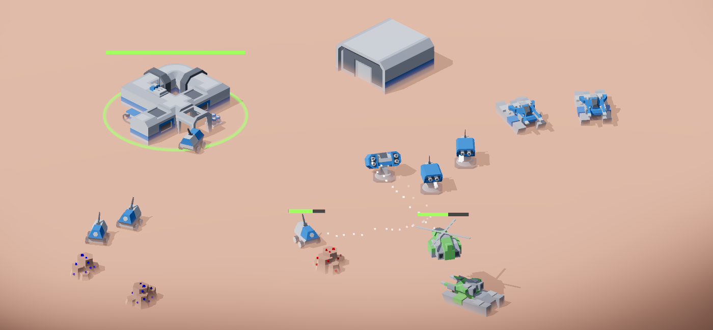
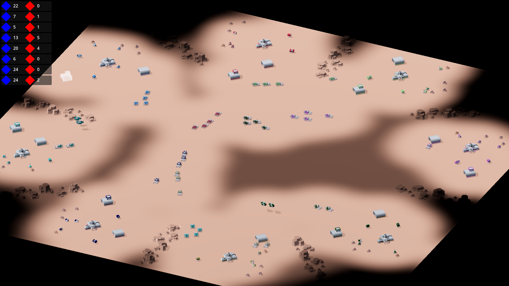

# Open RTS



Open Source real-time strategy game made with Godot 4.

Godot **4.7.2** presentation updates add event animations, text-scaled tooltip icons,
directional exhaust and dust, rotating debris, and saved vehicle tracks and blast marks.
In **Settings → Graphics**, enable **High-quality building lights** for soft base lighting
or **HDR output** for a supported display. Both are off by default. HUD animations
respect **Reduce bright combat flashes** and can also be disabled separately.

The latest [battlefield polish](docs/playtests/2026-10-23/POLISH.md) adds combat
impact feedback, faction selection shapes, patrols, smart rallies, adaptive music,
veterancy and plateau advantages. **Tab** cycles unit classes in a mixed selection;
**P** sets a looping patrol. Unit status captions appear only with **F1** diagnostics.
Technology and Coordination upgrades share an ordered queue with cancellation
and refunds. A commander list and announcement make player elimination visible
while preserving the HQ rebuild grace period.

## Game design

The evolving RTS design is recorded in
[the living game design document](docs/GAME_DESIGN.md),
[the strategic faction asymmetry specification](docs/FACTION_ASYMMETRY.md),
[the macro economy and harvesting specification](docs/MACRO_ECONOMY.md),
[the tactical micro-control and formations specification](docs/MICRO_AND_NAVIGATION.md), and
[the narrative and audiovisual presentation specification](docs/NARRATIVE_AND_PRESENTATION.md), including confirmed
decisions, proposed mechanics, and open questions.

The main menu's **Scenario Editor** builds and plays custom two- or four-player battlefields using modular scenery, deposits and capturable facilities. It includes undo/redo and portable map files; battle saves embed the custom map. See the [editor controls and verification](docs/playtests/2026-11-02/scenario-editor.md).

Units now use five built-in choices: **Auto-engage, Defensive, Follow, Guard and Hold Fire**. Choose them in the selected unit's Orders panel. Guard positions, follow targets, stances and queued direct orders persist in battle saves. Saves from earlier game versions are not loaded. See [unit behavior rules](docs/UNIT_BEHAVIORS.md) and [performance measurements](docs/performance/RESULTS.md).

The [core gameplay specification](docs/CORE_GAMEPLAY_SPEC.md) and older playtest reports retain the project's design history. Economy, faction rosters, research, repair, capture, hero campaigns, dialogue and battle archives remain available.

Command Horizon now has a [first environment kit pass](docs/playtests/2026-10-03/HORIZON_ENVIRONMENT.md): industrial landmarks, varied rock cuts, worn roads and verified aircraft clearance. [Industrial Crossroads](docs/playtests/2026-10-03/INDUSTRIAL_CROSSROADS.md) adds a three-street skirmish district and detailed buildings shared with Broken Foundry. [Moving neutral life](docs/playtests/2026-10-03/AMBIENT_LIFE.md) adds civilian traffic, walking residents and wildlife across six maps. [Neutral world interaction](docs/playtests/2026-10-11/neutral-world/README.md) adds eight-person infantry garrisons, explicit neutral targeting, panic reactions, animated destruction and persistent ruins. Right-click a habitable building with infantry to approach and capture it over 15 seconds; damage to the capturing infantry interrupts the attempt. After capture, infantry enter the shelter; select its occupants and move or choose **Leave building** to exit. Captured buildings keep their owner when emptied, including across saves. Enemy infantry can recapture an empty building; defended buildings must be cleared first. Use **Force attack** (**Ctrl+A**, then click) to attack damageable allied or neutral units and buildings. [Expanded infantry and faction heroes](docs/playtests/2026-10-11/infantry-heroes/README.md) adds rifle, anti-armor, sniper and assault infantry, plus one unique hero per player with a persistent gold aura. Train heroes at barracks after building a command lab; alive and queued heroes share the same limit, and fallen heroes can be retrained. [Coastal Foundry](docs/playtests/2026-10-03/COASTAL_FOUNDRY.md) adds a harbor inlet, two ground routes, an air shortcut, cranes, vessels and gulls. Its [coastal environment pass](docs/playtests/2026-10-04/COASTAL_ENVIRONMENT.md) now adds continuous sea/terrain, breakwaters and rocky headlands, port service yards and wind-shaped pines. [Desert Frontier](docs/playtests/2026-10-03/DESERT_ENVIRONMENT.md) now has layered sandstone shelves, canyon surroundings, abandoned extraction/freight landmarks and varied sand/haul-road materials. [Alpine Relay](docs/playtests/2026-10-03/ALPINE_ENVIRONMENT.md) adds glacial shelves, snowy mountain and conifer surroundings, communications stations and connected plowed routes. Final environment work remains in progress.

[Resource navigation and map startup](docs/playtests/2026-10-03/RESOURCE_NAVIGATION.md) now have verified narrow-gap routing, reliable gathering/delivery, and per-battle navigation. The field-access audit covers both factions and all 11 resource-bearing maps. [Crowded Move destinations](docs/playtests/2026-10-04/CROWDED_DESTINATION.md) now settle beside an ally occupying the final reachable point, allowing queued orders and stationary treatment to continue.

**Air combat:** every shot is a visible round that follows gravity, motor thrust or missile guidance and can miss. The runway airfield builds kamikaze drones, fighters, bombers and attack helicopters; jets taxi, take off, bank, land on a glide slope and rearm on their own stand. Rocket infantry fire guided missiles at aircraft, and each faction has a tank-class anti-air vehicle. See the [air-combat rules](docs/CORE_GAMEPLAY_SPEC.md#air-combat-and-physical-projectiles-2026-10-20).

[Air-defense guidance](docs/playtests/2026-10-05/AIR_DEFENSE.md) now selects compatible counters or offers existing anti-air cover, explicit Helix stance controls and real construction guidance when aircraft threaten your economy. [Live research feedback](docs/playtests/2026-10-05/RESEARCH_FEEDBACK.md) shows progress, available choices and lab-loss stalls in the existing command message area. [Resource inspection](docs/playtests/2026-10-05/RESOURCE_INSPECTION.md) shows observed deposit stock and wreck recovery details in one hover card, and aircraft ownership captions now respond to the pointer. The [engineer shortcut](docs/playtests/2026-10-05/ENGINEER_RESPONSE.md) selects endangered workers during raids and preserves their orders until you explicitly move them. Selected engineers can [Return cargo](docs/playtests/2026-10-06/CARGO_RETURN.md) to their nearest completed friendly HQ; hold Shift to queue delivery after a retreat.

[Faction and unit audio](docs/playtests/2026-10-11/audio-enhancement/README.md) now gives
all three factions distinct announcers, character-specific synthetic unit voices,
autonomous machine responses, research/construction/production cues and subtle UI
sounds. A shared priority queue, cooldowns and duplicate suppression keep battle
notifications from overlapping. Speech follows **Voice volume**; machine and UI
sounds follow **Effects volume**.

## Play skirmish

Run `project.godot` in **Godot 4.7.2** and choose **SKIRMISH**, or double-click [`play-skirmish.command`](play-skirmish.command) on this Mac.

- Play **Bastion**, **Helix**, or **Free Frontier**, against any faction or **Random** (mirror matches supported).
- Choose among 16 battlefields for two or four players, including **Desert Frontier**, **Alpine Relay**, **Coastal Foundry** and **Copper Badlands**, with **Easy / Normal / Hard** AI. Sparse legacy maps are retired from new-game selection.
- **Standard:** HQ, four engineers, two infantry, 60 materials / 12 electronics. **Advanced:** established base, tanks and repair support, 120 / 60.
- **Economy:** each resource field has five material piles and two electronics piles. Fresh skirmish homes use short, roughly 9 m HQ arcs, with 600 materials per pile and 720 electronics per node. Expansion reserves are 900 / 1,200; rich fields hold 1,200 / 1,800. Campaign supplies and existing saved deposits retain their authored amounts and positions. Full heaps change into opened bundles, scattered parts, and scraps at 300, 150, and 60 remaining; empty piles disappear. Electronics normally take 1.5 seconds per item to collect. Faction harvesters differ in cargo, movement and delivery; Bastion can build forward refineries. HQs supply 8 power and generators supply 12, while demand varies by faction and buildings.
- **Battle controls:** direct orders, unit behaviors, production queues and engineer assignment shortcuts.
- Harvest, construct, produce, repair and fight with all three faction rosters. Each side has a **100 mobile-unit cap**, including queued reinforcements, and a separate **40-structure cap** including foundations.
- **Default keys:** **M + left-click:** move without engaging. **A + enemy click:** attack a visible target; **A + empty ground:** attack move. **Ctrl+A + target click:** force attack, including allied and neutral units/buildings. **F + left-click:** attack move. **P + left-click:** patrol. **Tab:** cycle selected unit classes. The selection panel has matching buttons; hold **Shift** when choosing the target to queue. **Esc / right-click** cancels targeting. [Direct command verification](docs/playtests/2026-10-04/DIRECT_ORDERS.md). **Space:** tactical pause with orders, construction and production available. **Esc:** controls, resume, restart, setup or main menu.
- **Options / Esc → Settings:** preview master/voice/effects volume, speech subtitles (three text sizes), camera speed, edge scrolling, window mode, pointer confinement and reduced flashes. Save keeps changes; Cancel/Esc restores them. **Controls** remaps 49 battle, camera, formation, queue/selection and control-group actions, with conflict feedback and per-action reset. Displayed battle shortcuts follow your bindings. Tab/Enter navigate controls; Esc cancels capture or closes dialogs. See [controls verification](docs/playtests/2026-10-03/KEY_CONTROLS.md). Subtitles remain readable with audio muted. Urgent warnings take priority over routine voice responses; repeated casualties no longer restart a line for each loss. [Speech verification](docs/playtests/2026-10-03/SPEECH_ACCESSIBILITY.md). Attacks, hits and infantry/vehicle/building destruction have distinct combat sounds, with stereo direction and current-fog filtering. **Test combat sound** previews the Effects setting. [Combat audio verification](docs/playtests/2026-10-03/COMBAT_AUDIO.md).
- **Interface size:** Settings → General → Display offers **100%, 125%, and 150%**, with live preview and Save/Cancel. It scales menus, battle controls and text; subtitle size remains adjustable separately. [Scaling verification](docs/playtests/2026-10-03/INTERFACE_SCALE.md).
- **Alerts:** open the top-right history to inspect incoming fire, grouped losses, idle engineers, depleted fields, stranded cargo, low power and blocked production. **Show** selects affected friendly units and centers the camera; **Go to field** visits the assignment area. Both work while paused. Close with the displayed Menu key; Clear history retains active problems. [Alert verification](docs/playtests/2026-10-03/BATTLE_ALERTS.md).
- **Esc → Save / Load battle:** five manual slots and three campaign checkpoints. **F5:** quicksave. **F9:** review quickload. The main menu also has **LOAD BATTLE**. Loaded battles remain paused until Resume.
- Destroy the enemy HQ and prevent a completed replacement for **60 seconds**. Losing every unit/building also ends the match. Victory, defeat and draw screens support replay and return to setup.

Each faction has dedicated unit roles, models, weapons and exclusive research. Helix relies on regenerating shields, hover movement and directed-energy weapons; Bastion emphasizes durable defenses and deployed siege fire; Frontier uses rapid batches, mobile infantry mounts and battlefield salvage. The AI gathers and pays for units, buildings and research, reserving eligible technology costs while prioritizing rebuilding and urgent production. Easy / Normal / Hard skirmish commanders differ in decision speed, attack timing and size, economy, production, research and retreats, without economic or combat bonuses ([difficulty profiles](docs/CORE_GAMEPLAY_SPEC.md#enemy-fairness-and-difficulty)). See [paid progression verification](docs/playtests/2026-10-05/PAID_PROGRESSION.md) and the [reproducible match runner](tests/playtest/README.md).

[Implemented rules and limits](docs/GAME_DESIGN.md#19-playable-two-faction-skirmish--implemented-2026-10-01) · [Verification report](docs/playtests/2026-10-01/SKIRMISH.md)

```sh
godot --headless --path . --fixed-fps 60 --script tests/headless/Skirmish.gd
godot --headless --path . --fixed-fps 60 --script tests/headless/NavigationRegression.gd
godot --path . --fixed-fps 60 --script tests/rendered/SkirmishPreview.gd
```

Combat now includes armor/weapon counters, blocked sight and fire, non-stacking repair, infantry/aircraft recovery, recoil, tracers, missile trails, impacts and temporary wrecks. [Rules and measurements](docs/playtests/2026-10-01/COMBAT.md) · [Development roadmap](docs/DEVELOPMENT_ROADMAP.md).

Both factions now have individual long-idle gestures, gait/hover timing, recoil and death variations. [Motion rules and verification](docs/playtests/2026-10-01/UNIT_MOTION.md).

Choose **Auto-engage**, **Defensive**, **Follow**, **Guard** or **Hold Fire** in the Orders panel. Behaviors require no setup or network connection. Follow selects a friendly unit; Guard selects a position. Ordinary move, attack, gathering, construction and repair orders remain available.

```sh
godot --headless --path . --fixed-fps 60 --script tests/headless/CombatRegression.gd
godot --path . --script tests/rendered/ScaleFrameBenchmark.gd -- --behaviors --realtime --no-capture
godot --path . --fixed-fps 60 --script tests/rendered/CombatPreview.gd
```

## Hero campaigns

**CAMPAIGN** offers three connected stories about Meridian and Cinder Ford: six Bastion operations led by Marshal Aegis, five Helix operations led by Spectre Nyx, and five Frontier operations led by Pathfinder Rook. Choose a faction, operation and difficulty. Heroes must survive, gain stronger abilities in later acts, and accompany the army to story objectives. The battle HUD provides hero selection, ability activation, convoy orders and dialogue skip controls.

Bastion proceeds through **Supply Line**, **First Orders**, **Split Signal**, **Cinder Ford**, **Broken Foundry** and **Command Horizon**. Cinder Ford completion supplies the foundry rescue bonus; campaign progress that recorded the retired Air Corridor evacuation still counts toward it. In Broken Foundry, disable the production nodes and secure the foundry with infantry. In Command Horizon, secure deployment, defeat the command force, then bring Aegis to the Spire controls. Finale victory unlocks Lean and Reinforced replay variants.

Helix's **Quiet Streets**, **The Gate**, **Cinder Ford**, **Pruning** and **Severance**, and Frontier's **Drainage**, **Cinder Ford**, **Salvage**, **Wren** and **The Coalition** combine capture, hold, destruction and escort objectives. Their city, river, drainage and desert theaters include resources, story landmarks, interior buildings, groves and moving residents, with mission routes and construction areas kept clear. English voices use English or Chinese captions; captions default to off and can be enabled in settings. Conversations can be paused, skipped and resumed from a battle save.

The earlier [continuation report](docs/playtests/2026-11-02/headless-continuation/README.md) tracks version 22 integration. Its frozen macOS `qualified-run-5` passes **140/140 packaged scripts**, the strict pre-export source texture check, 811 archived saves with 389 recorded checksums, 1,152 layout cases with zero failures, **14/14 actual multiplayer/replay checks**, six dummy resource-lifetime instances and startup/clock checks: all **162 workflow rows** pass. The [current headless report](docs/playtests/2026-11-02/headless-continuation/candidate5/report.json) includes the final command and CPU query changes; [artifact verification](docs/playtests/2026-11-02/headless-continuation/candidate5/artifact-verification.json) confirms matching package hashes and zero source drift. ARM64 executed on macOS; the universal x86-64 slice was structurally checked only. This does not claim Windows/Linux execution. Candidate 4's [earlier pass](docs/playtests/2026-11-02/headless-continuation/final/report.json), failed workflows and the [October campaign report](docs/playtests/2026-10-16/headless-continuation/README.md) remain preserved.

Graphical game launches were subsequently authorized. The [engine modernization verification](docs/plans/2026-11-02-engine-modernization.md) covers compilation, native/navigation regressions, 520-body selection, rendered saves and fog, bilingual HUDs, environment effects, combat audio and actual Metal/OpenGL teardown. Its [consolidated results](docs/playtests/2026-11-02/engine-modernization/verification.json) retain all failures and final source/artifact hashes. The earlier 140-suite package pass applies to its frozen source, before these engine changes.

The final release-template formation sample keeps all 200 units selected and visible through 240 focused frames: dispatch 10.260 ms, median/p95/maximum frames 14.133/17.285/23.081 ms. Strict MI12 still fails its 16.6 ms maximum-frame limit. Both fog backends complete all five full 4K phases, but low throughput and population loss reject their fixtures. Six broader regression suites also fail on the pre-modernization revision. Full release acceptance remains open; the original 3D assets are unchanged.

Earlier [passenger and bilingual briefing reviews](docs/playtests/2026-11-02/graphical-resume/README.md), [OpenGL lifetime checks](docs/playtests/2026-11-02/graphical-resume/opengl/README.md) and [failed formation timings](docs/playtests/2026-11-02/tactical-formations/fact-reuse-release/README.md) remain preserved.

Choose **CAMPAIGN → First Orders → Start First Orders**. Build a command lab, assign a Guard position, then send infantry and armor to the relay. Hold it for 60 uncontested seconds against three warned Helix responses.

Using Guard and Follow together earns the optional cosmetic doctrine badge. Mission completion, the badge and full battle state persist. **Esc → Save / Load battle** opens the battle archive.

```sh
godot --headless --path . --fixed-fps 60 --script tests/headless/CampaignRegression.gd
godot --path . --fixed-fps 60 --script tests/rendered/CampaignPreview.gd
```

## Bastion playable demo

Open `project.godot` in **Godot 4.7.2**, run the project, and choose **BASTION DEMO**. On this Mac, double-click [`play-bastion.command`](play-bastion.command) to launch directly. A Godot executable is required; the launcher checks the local tool download, cache, application folder, and PATH.

The desert scenario starts with the full faction available for review: **8 mobile unit types, 9 structures, materials/electronics harvesting, power capacity, construction, production, repairs, fog of war, and an AI opponent**. Reinforcements cost resources; the command lab unlocks walkers and railgun tanks. Destroy all enemy units and structures to win. Use **SKIRMISH** for the three-faction mode described above.

- **Left-click / drag:** select. **Shift:** add to selection. **Right-click:** move, attack, harvest, repair an ally, or set a factory rally point. **Shift + right-click:** append an order (up to 16 waiting). **Shift + attack-move click:** append an attack-move.
- **Unit behaviors:** Attack, Defensive, Follow, Guard and Hold Fire are available immediately in Orders.
- **Order queue:** numbered routes show active (solid) and waiting (dashed) orders. Skip advances one order; Clear waiting keeps the active order; Stop clears everything.
- **Engineer rover:** select a building in its menu, place it with the left mouse button, and rotate with **R** or by dragging before release. Right-click cancels placement.
- **Production:** select a headquarters, barracks, vehicle factory, or airfield. Click a labelled roster tile to queue one unit; **Shift-click** queues up to five within your available resources, unit cap and queue space. Click a queue icon to cancel and refund. Build, Produce, Research and Orders use directly accessible labelled tabs, with names and costs visible on their choices.
- **Space:** tactical pause in the Bastion demo; select units, give orders, and queue production while paused. **Escape:** match menu.
- **Arrow keys / screen edges:** pan. **Q/E:** rotate. **Mouse wheel:** zoom. **Ctrl+1–9:** assign control groups; **1–9:** recall.

Assets and implementation:

- [Editable Blender faction catalogue](art/bastion/demo/bastion_faction.blend) · [asset overview](art/bastion/demo/faction-catalogue.png)
- [Rebuild script](art/bastion/build_faction.py) · [20 GLB exports](assets/models/bastion/demo) · [unit/building icons](assets/ui/bastion) · [verified mesh counts](art/bastion/demo/verification.json)
- [Gameplay specification and prototype limitations](docs/GAME_DESIGN.md#16-bastion-asset-and-gameplay-demo--implemented-2026-10-01)

Rebuild the assets with `blender --background --factory-startup --python-exit-code 1 --python art/bastion/build_faction.py`. The script uses the original tank export in `assets/models/bastion/tank-v1/` and saves editable source, GLBs, icons, and a catalogue render. Validate exports with the same command using `art/bastion/verify_faction.py`.

Verification commands, from the project directory:

```sh
godot --headless --editor --path . --import
godot --headless --path . --script tests/headless/MatchStartup.gd
godot --headless --path . --script tests/headless/BastionDemo.gd
godot --path . --script tests/rendered/BastionPreview.gd
gdformat --check source/
gdlint source/
```

Latest gameplay verification: [repeated skirmishes, repair support and movement completion](docs/playtests/2026-10-03/SKIRMISH_MATRIX.md), followed by [crowded-base movement and archive continuity](docs/playtests/2026-10-03/CROWD_BOUNDARIES.md), [AI construction that preserves base access](docs/playtests/2026-10-03/BASE_ACCESS.md), [tactical guidance and reliable selection](docs/playtests/2026-10-03/BATTLE_PLAN.md), [Guard coverage across its assigned area](docs/playtests/2026-10-03/GUARD_AREA.md), [observed-threat AI defense](docs/playtests/2026-10-04/AI_DEFENSE.md), [observed-composition counter-production](docs/playtests/2026-10-04/AI_COMPOSITION.md), [strategic offensive objectives](docs/playtests/2026-10-04/AI_OFFENSE.md), [protected expansion and cargo-preserving withdrawal](docs/playtests/2026-10-04/AI_EXPANSION.md), [adaptive AI labor and mixed-production budgets](docs/playtests/2026-10-04/AI_ECONOMY.md), [AI recovery and recommitment](docs/playtests/2026-10-04/AI_RECOVERY.md), [intermittent-movement investigation and replay](docs/playtests/2026-10-04/MOVEMENT_DIAGNOSTICS.md), and [global AI task coordination](docs/playtests/2026-10-04/AI_COORDINATION.md).

This is a playable art/gameplay prototype with built-in unit behaviors, three factions, 16 hero campaign operations, and full battle save/load.

## Helix Systems — second faction models

Choose **HELIX MODEL REVIEW** in the main menu to inspect all **8 units and 9 structures**. Use the wheel to zoom, Q/E to turn, Space to pause rotation, and the team-color button to test recoloring. This viewer remains available alongside the playable Helix faction in **SKIRMISH**.

[Unit concept sheet](docs/concept-art/helix/v1/02-helix-unit-designs-v1.png) · [Building concept sheet](docs/concept-art/helix/v1/03-helix-structure-designs-v1.png) · [Faction key art](docs/concept-art/helix/v1/01-helix-key-art-v1.png) · [Exact imagegen prompts](docs/concept-art/helix/v1/prompts.json)

[Editable Blender source](art/helix/v1/helix_faction.blend) · [Model catalogue](art/helix/v1/faction-catalogue.png) · [GLBs](assets/models/helix/v1/) · [Faction design](docs/GAME_DESIGN.md#17-helix-systems--second-faction-design-and-model-set)

Rebuild with `blender --background --factory-startup --python-exit-code 1 --python art/helix/build_faction.py`; validate with `art/helix/verify_faction.py`. Run `godot --path . --script tests/rendered/HelixPreview.gd` to inspect every model through the Godot importer and capture review screenshots.

## Purposes of this project

This game is not going to be a very advanced RTS that would compete with other games of this genre. Instead, it will focus on simplicity and clean design so that it can:
 - showcase Godot 4 capabilities in terms of developing RTS games
 - provide an open-source project template for creating RTS games
 - educate game creators on creating RTS game mechanics

## Features

 - [x] 1 species
 - [x] 2 resources
 - [x] terrain and air units
 - [x] deathmatch mode (human vs AI or AI vs AI)
 - [x] runtime player switching
 - [x] basic fog of war
 - [x] units disappearing in fog of war
 - [x] minimap
 - [x] swarm movement to position
 - [ ] swarm movement to unit
 - [x] simple UI
 - [ ] polished UI
 - [ ] sounds
 - [ ] music
 - [ ] VFX

## Godot compatibility

This project targets **Godot `4.7.2-stable`** (standard edition), including matching
export templates. Download it from the [official release page](https://godotengine.org/download/archive/4.7.2-stable/).
The desktop release pipeline uses this exact version.

On macOS, the launchers look for `tmp/tooling/godot-4.7.2/Godot.app` in the current
checkout and then the main checkout when running from a linked Git worktree,
`~/.cache/godot/4.7.2/Godot.app`, `/Applications/Godot.app`, then `godot` on PATH.
The launchers check the executable version and skip anything other than 4.7.2 stable.

 - support for Godot `4.6` is available in project history before the Godot `4.7.2` upgrade.
 - support for Godot `4.3` is available in project history before the Godot `4.6` upgrade.
 - support for Godot `4.2` is available on `godot-4.2-support` branch.
 - support for Godot `4.1` is available on `godot-4.1-support` branch.
 - support for Godot `4.0` is available on `godot-4.0-support` branch.

## Screenshots




## Contributing

Everyone is free to fix bugs or perform refactoring just by opening PR. As for features, please refer to existing issue or create one before starting implementation.

## Credits

### Core contributors
 - Pawel Lampe (Lampe Games)

### Contributors

See [contributors](https://github.com/lampe-games/godot-open-rts/graphs/contributors) page.

### Assets
 - 3D Space Kit by [Kenney](https://www.kenney.nl/assets/space-kit)

- Visible heavy-armor defense advice and repeated factory-selection layout verification: [2026-10-06 report](docs/playtests/2026-10-06/GROUND_DEFENSE.md).

- Paid opening infantry guidance, full Standard progression and native reselection follow-up: [2026-10-06 report](docs/playtests/2026-10-06/OPENING_INFANTRY.md).

- Program recovery support, role-specific first assignments and paid healing under enemy pressure: [2026-10-06 report](docs/playtests/2026-10-06/PROGRAM_RECOVERY.md).

- Selected-unit control width, UI-scale transitions and native command cancellation audit: [2026-10-06 report](docs/playtests/2026-10-06/MENU_WIDTH.md).

- Low-health combat/support selection during defense pressure: [2026-10-06 report](docs/playtests/2026-10-06/LOW_HEALTH_SELECTION.md).

- Cross-map paid recovery and progression audit, including unresolved strategy/rendering findings: [2026-10-06 evidence](docs/playtests/2026-10-06/REGIONAL_RECOVERY.md).
- Named skirmish relay overview, camera locators and public fog markers: [2026-10-06 verification](docs/playtests/2026-10-06/RELAY_OVERVIEW.md).
- Own-force battle debrief and persistent production/loss/programming history: [2026-10-06 verification](docs/playtests/2026-10-06/BATTLE_DEBRIEF.md).
- Opening repair-support discovery alongside lab and defense advice: [2026-10-06 verification](docs/playtests/2026-10-06/SUPPORT_DISCOVERY.md).
- Early paid support, conventional armor recovery and chip handoff: [2026-10-06 verification](docs/playtests/2026-10-06/ARMOR_PRESERVATION.md).
- Sustained paid recovery, air-reserve conflict and experimental ground screens: [2026-10-06 audit](docs/playtests/2026-10-06/SUSTAIN_PRESSURE.md).
- Partial recovery-command coverage and faction-specific missing-service feedback: [2026-10-06 report](docs/playtests/2026-10-06/RECOVERY_COVERAGE.md).
