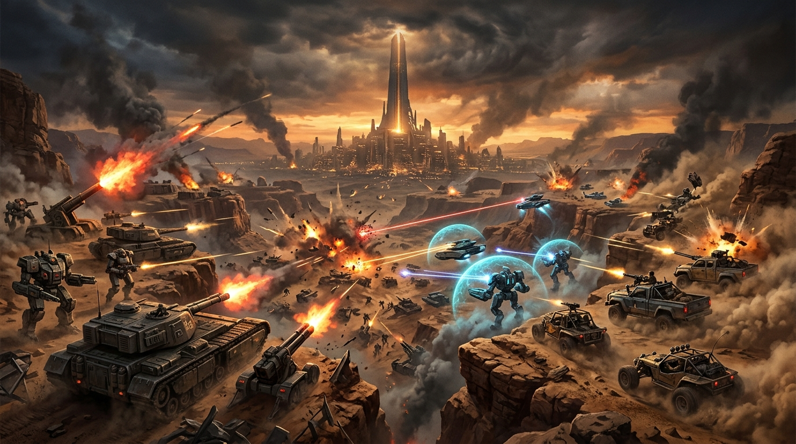
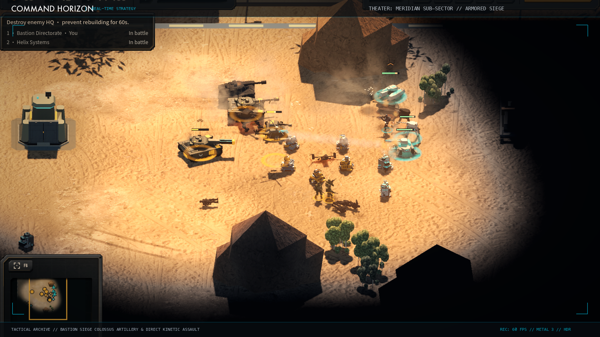
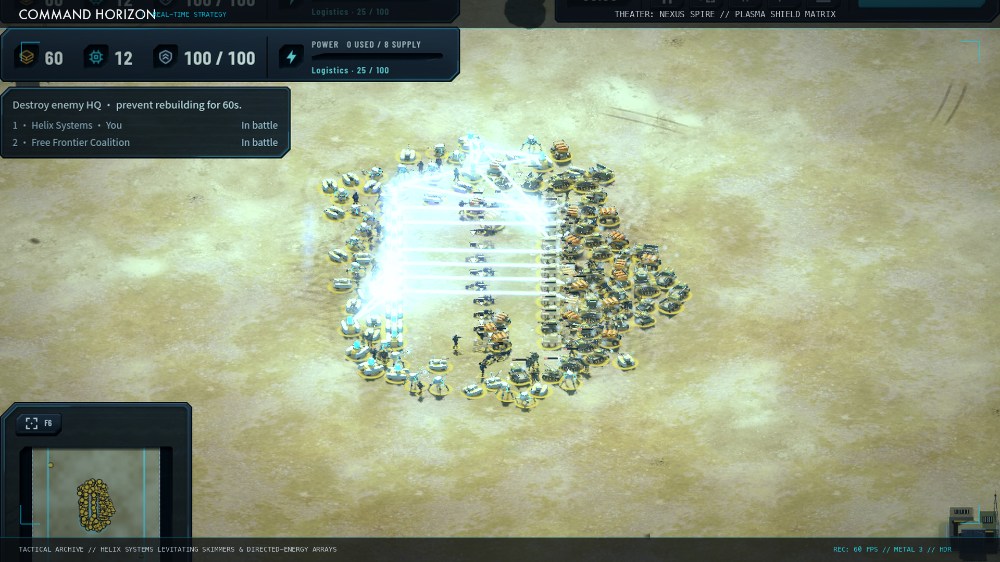
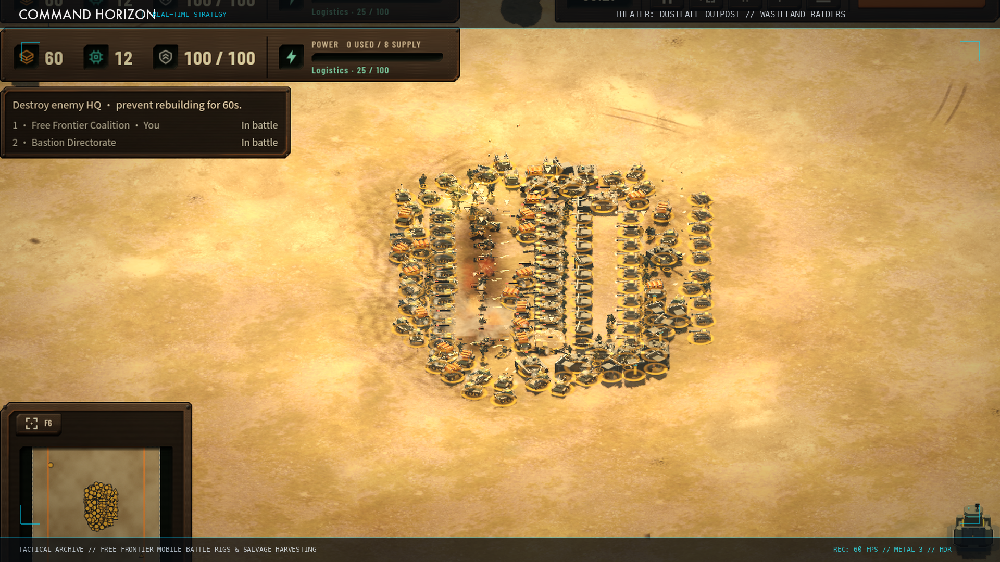
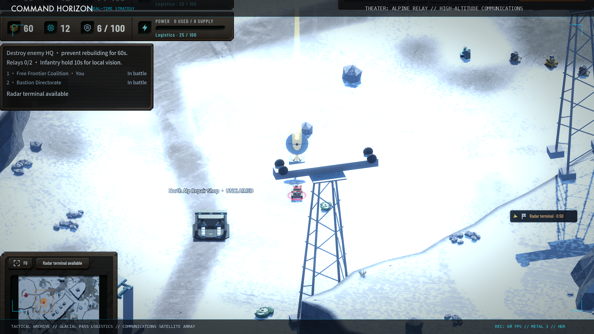
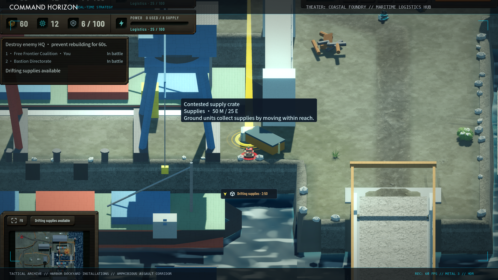
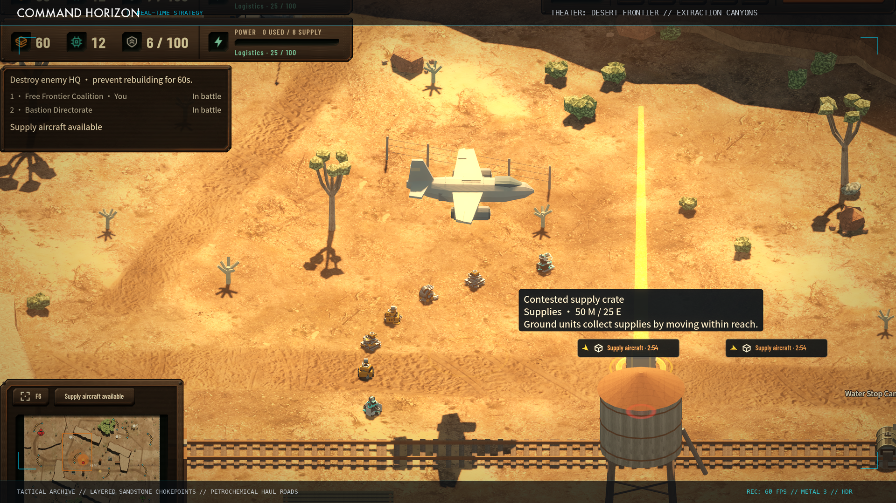
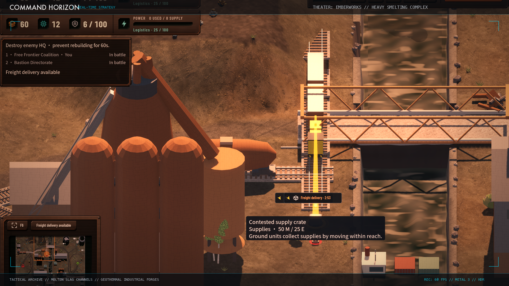
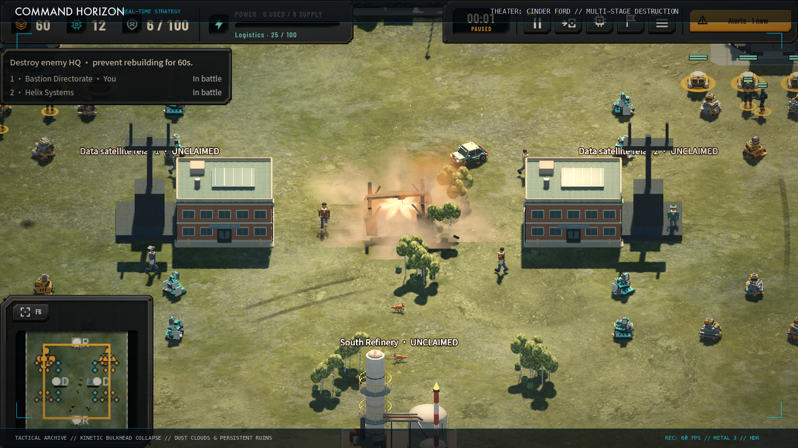

# Command Horizon



[](https://godotengine.org/)
[](LICENSE)
[](#system-requirements)
[](#tech-stack--architecture)

**Command Horizon** is a classic, competitive 3D Real-Time Strategy (RTS) game built with **Godot 4** and **C++ GDExtension**. Synthesizing design lessons from genre benchmarks (*Command & Conquer*, *StarCraft II*, and *Age of Empires II*), it delivers full macro base construction, asymmetric faction doctrines, true physical ballistics, dynamic multi-stem audio, and dedicated room-server multiplayer.

---

## The Conflict of Meridian

The towering industrial metropolis of **Meridian** has fallen silent. Following a catastrophic network severance order, the gates were sealed and civil order disintegrated. Three distinct ideological factions now wage a bitter war for control of logistics relays, salvage yards, and the central Meridian Spire:

```
                     ┌──────────────────────────────────────────────┐
                     │          FACTION ASYMMETRY TRIAD             │
                     └──────────────────────────────────────────────┘
                                    /              \
                                   /                \
                                  /                  \
              BASTION DIRECTORATE                    HELIX SYSTEMS
         "The Fortified Juggernaut"             "The Cybernetic Energy Swarm"
         • High Armor / Ballistic Fire          • Regenerating Plasma Shields
         • Tethered Worker Construction         • Autonomous Nanite Assembly
         • Deployable Siege Colossus            • Coherent Laser Refraction
         • Bunkers & Continuous Repair          • Phase-Shift Kiting Tactics
                                  \                  /
                                   \                /
                                    \              /
                              FREE FRONTIER COALITION
                          "Scavenger Swarm & Wasteland Raiders"
                          • Paired Batch Production
                          • Battlefield Wreck Salvage
                          • Mobile Garrison Battle Rigs
                          • Concealed Proximity Traps
                          • Fast Hit-and-Run Ambush
```

---

## Core Features

### 1. Macro Economy & Asymmetric Harvesting
- **Dual Resource System:** Harvest **Materials** for bulk structure foundations and armored hulls; refine **Electronics** for advanced directed-energy weapons, radar tech, and aircraft.
- **Dynamic Field Depletion:** Resource nodes visually degrade from full heaps into opened bundles, scattered scrap, and depleted craters over time.
- **Power Grid Management:** Construct power plants to sustain manufacturing speeds; low power stalls advanced radar and defensive emplacements.

### 2. Tactical Micro-Control & Formations
- **Five Stance Behaviors:** Switch units between **Auto-engage**, **Defensive**, **Follow**, **Guard**, and **Hold Fire** in the Orders panel.
- **Tactical Movement:** Attack-move (`A`), Force Attack (`Ctrl+A`), looping Patrols (`P`), and class cycling (`Tab`) in mixed-army selections.
- **Infantry Garrisons:** Right-click neutral or captured buildings to garrison infantry squads for defensive firing corridors.

### 3. Air Combat & Physical Ballistics
- **True Projectile Simulation:** Every cannon round, flak burst, and rocket follows physical ballistics with gravity, velocity, or missile guidance arcs that can miss moving targets.
- **Airfield Logistics:** Construct runway airfields to deploy kamikaze drones, fighters, bombers, and attack helicopters that taxi, take off, bank, and rearm on their flight stands.
- **Multi-Stage Building Destruction:** Structures buckle under critical damage, collapsing through physics debris and leaving persistent, salvagable ruins.

### 4. 16 Connected Campaign Operations
- **Three Linked Perspectives:** Follow **Marshal Aegis** (Bastion), **Spectre Nyx** (Helix), and **Pathfinder Rook** (Frontier) across 16 authored operations.
- **Hero Units & Interactive Hubs:** Upgrade commanders with persistent doctrine badges; review tactical intelligence between missions in faction command stations.
- **Bilingual Briefings:** Fully voiced character lines with English and Chinese subtitle support.

### 5. Dedicated Multiplayer & Scenario Editor
- **Room Server Directory:** Host dedicated headless matches or connect through server rooms with automated port forwarding (UDP 28761–28765) for 1v1 duels and 2v2 team skirmishes.
- **In-Engine Scenario Editor:** Create, test, and export custom battlefields with modular terrain, resource deposits, and capturable neutral structures.

---

## Screenshots

| **Meridian Sub-Sector // Armored Siege** | **Nexus Spire // Plasma Shield Matrix** |
|:---:|:---:|
|  |  |
| *Bastion Siege Colossus artillery & heavy tank assault* | *Helix levitating skimmers & cyan shield bubbles* |

| **Dustfall Outpost // Scavenger Convoy** | **Alpine Relay // High-Altitude Logistics** |
|:---:|:---:|
|  |  |
| *Free Frontier Battle Rigs & salvage teams* | *Glacial mountain pass & communications satellite dishes* |

| **Coastal Foundry // Maritime Dockyards** | **Desert Frontier // Sandstone Canyons** |
|:---:|:---:|
|  |  |
| *Deepwater harbor breakwaters & naval approaches* | *Layered sandstone shelves & extraction pipelines* |

| **Emberworks // Heavy Smelting Complex** | **Cinder Ford // Structural Collapse** |
|:---:|:---:|
|  |  |
| *Molten slag channels & geothermal foundry forges* | *Multi-stage building collapse & persistent battlefield ruins* |

---

## Quickstart & How to Play

### Prerequisites
- **Godot Engine 4.7.2+** (Standard or .NET build with Forward+ renderer support). Download from the [official Godot website](https://godotengine.org/download/).

### Launching the Game
1. Clone this repository:
   ```sh
   git clone https://github.com/natelindev/command-horizon.git
   cd command-horizon
   ```
2. Open `project.godot` inside Godot 4.7+, or launch directly from the terminal:
   ```sh
   godot --path . res://source/main-menu/Play.tscn
   ```
   *(On macOS, you can also double-click [`play-skirmish.command`](play-skirmish.command) or [`play-bastion.command`](play-bastion.command)).*

### Running a Dedicated Headless Multiplayer Server
Launch a persistent server supporting up to 4 concurrent match rooms:
```sh
godot --headless --path . -- --room-server --port=28761 --max-rooms=4
```
For a single preconfigured 1v1 match:
```sh
godot --headless --path . -- --dedicated-server --mode=1v1 --port=28761
```

### Running Test Suites
Run headless verification regressions:
```sh
godot --headless --path . --fixed-fps 60 --script tests/headless/Skirmish.gd
godot --headless --path . --fixed-fps 60 --script tests/headless/NavigationRegression.gd
godot --headless --path . --fixed-fps 60 --script tests/headless/CombatRegression.gd
```

---

## Key Bindings Reference

| Key | Action |
| :--- | :--- |
| `A` + Left-Click | Attack target or Attack-Move to destination ground |
| `Ctrl + A` + Click | **Force Attack** (target allied or neutral structures/units) |
| `M` + Left-Click | Move order (units ignore enemy contact until arrival) |
| `P` + Left-Click | Set a looping patrol route |
| `Tab` | Cycle selected unit classes within a mixed army selection |
| `Shift` + Order | Queue additional movement, building, or attack commands |
| `Space` | **Tactical Pause** (issue orders, build structures, and plan queues while paused) |
| `F5` / `F9` | Quicksave / Quickload battle state |
| `F1` | Toggle combat telemetry and unit diagnostics |

---

## Tech Stack & Architecture

- **Engine:** Godot Engine 4.7+ (Forward+ Renderer, Metal 3 on Apple Silicon, Vulkan on Linux/Windows).
- **Core Scripting:** GDScript with strict static typing and signal-driven event dispatch.
- **Native Acceleration:** C++ GDExtension runtime for high-density crowd navigation and spatial entity queries.
- **Audio Architecture:** Multi-stem dynamic music director (`source/audio/MusicDirector.gd`) reacting in real time to combat intensity.
- **Shaders:** Custom GLSL shaders for fog-of-war revelation, weapon charge-up glow, plasma shield ripples, and building damage weathering.

---

## License & Credits

- **Game Engine & Source Code:** Released under the [MIT License](LICENSE).
- **Original Foundation:** Built upon and evolved from the open-source RTS prototype by Pawel Lampe ([Lampe Games](https://github.com/lampe-games/godot-open-rts)).
- **3D Space & Industrial Models:** Based on Kenney's public domain CC0 3D asset kits ([Kenney.nl](https://www.kenney.nl/assets/space-kit)).
- **Artwork & Shaders:** Original concept key art and shaders authored for *Command Horizon*.
