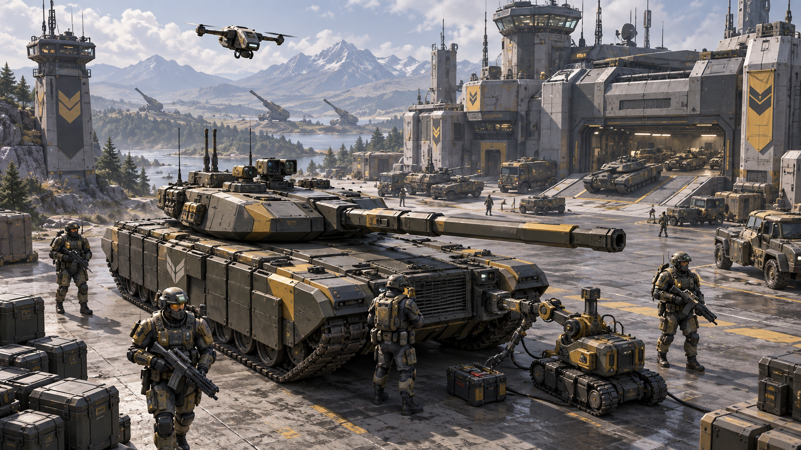
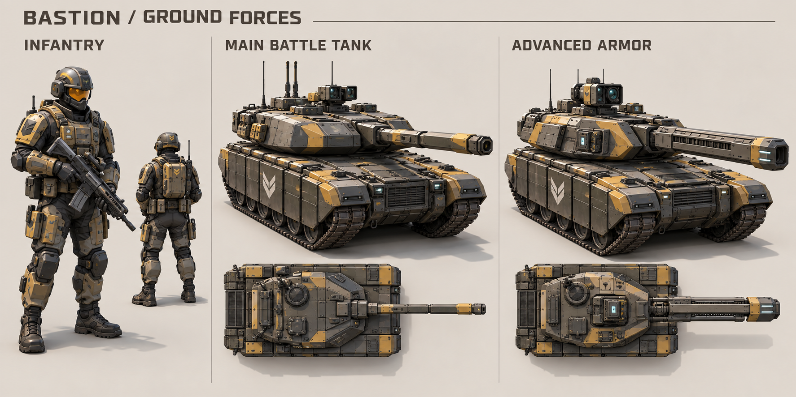
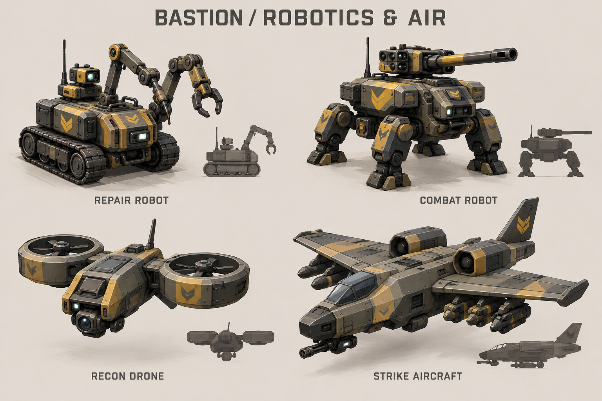
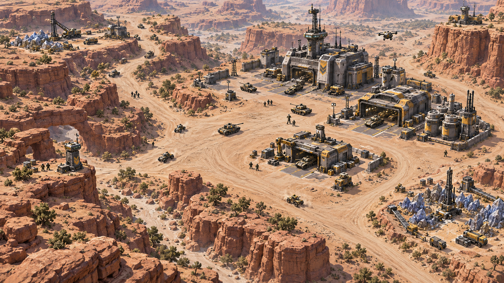
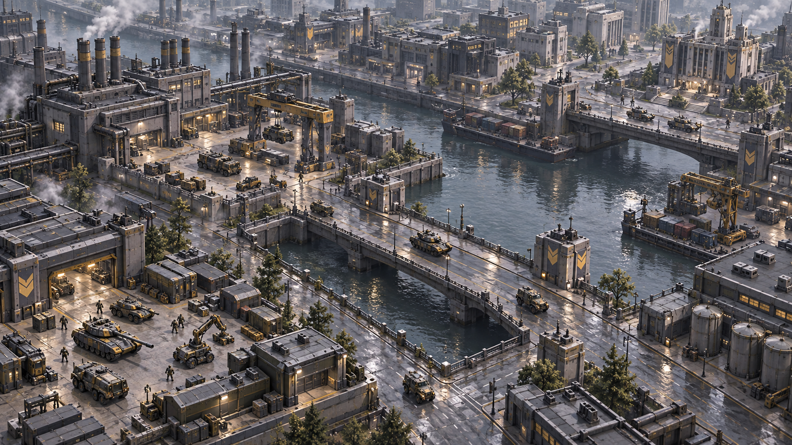
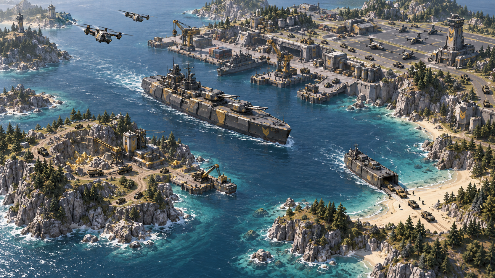

# Bastion concept art — Review set 01

Created: 2026-10-01. Generated with the built-in `image_gen` tool. All six images are provisional concepts awaiting user review, not approved production assets or gameplay screenshots.

This set explores the heavy mechanized first faction from the [game design](../../../GAME_DESIGN.md): broad industrial armor, oversized weapons, support robots, programmable machines, and readable combined-arms roles. The generated gray/olive materials, yellow markings, chevron motif, and control-module appearance are visual proposals, not newly confirmed faction requirements.

The [exact prompt set and generation manifest](prompts.json) records each prompt, source file, reference relationship, and saved asset filename. Images 02–06 use image 01 as a visual reference. Original generated files were preserved; workspace copies are stored alongside this index.

## 01 — Faction identity

Review the overall military-industrial character, armor mass, exaggerated proportions, and relationship between conventional forces and robotics. The composition establishes mood; relative sizes are illustrative.

## 02 — Ground forces

Infantry front/rear exploration and conventional/advanced tank family comparison, including overhead views. The advanced weapon and chip housing are proposals. These views are conceptual references, not dimensionally consistent modeling blueprints. The infantry armor is substantial; review whether it should look lighter for an early-game soldier.

## 03 — Robotics and air

Four distinct roles: tracked repair support, a compact combat walker, ducted reconnaissance drone, and heavy strike aircraft. Portraits are not at a shared scale. The walker configuration and aircraft design are exploratory additions to the broader unit families, not a locked initial roster.

## 04 — Desert frontier

Open tank maneuver space, rock formations, flanking approaches, and exposed extraction sites. The image introduces stylized mineral outcrops; their appearance does not finalize the economy or imply an additional resource. Terrain connectivity and exact building footprints still require playable map design.

## 05 — Industrial river city

Bridges, factory yards, and constrained approaches contrast with the desert's open ground. Review industrial density, wet-weather readability, and opportunities for holding crossings. Final gameplay assets may need simpler surfaces, more open streets, and camera-occlusion handling.

## 06 — Coastal archipelago

Separated land areas, naval channels, a harbor/airfield, and a landing beach explore combined land/air/sea operations. Battleships and transport mechanics remain conditional scope. This picture does not commit the first playable version to naval combat.

## Review notes

All six images were visually inspected. The unit sheet labels are readable and the requested subject families and contrasting environments are present. Files were verified as PNGs and the workspace copies match their generated originals.

The scenes lean toward detailed rendered illustration. Production assets should retain the useful large shapes while testing reduced detail, stronger unit/background separation, and appropriate scale at the actual RTS camera. Environment images are visual concepts, not validated maps or performance targets.

Useful feedback for the next pass:

- Keep or change the gray/olive armor and yellow markings?
- Keep this level of realism, or move toward more simplified, exaggerated shapes?
- Which unit designs feel distinctive, and which need a stronger identity?
- Which setting should become the first playable map?

No visual choice in this set is approved until the user reviews it.
